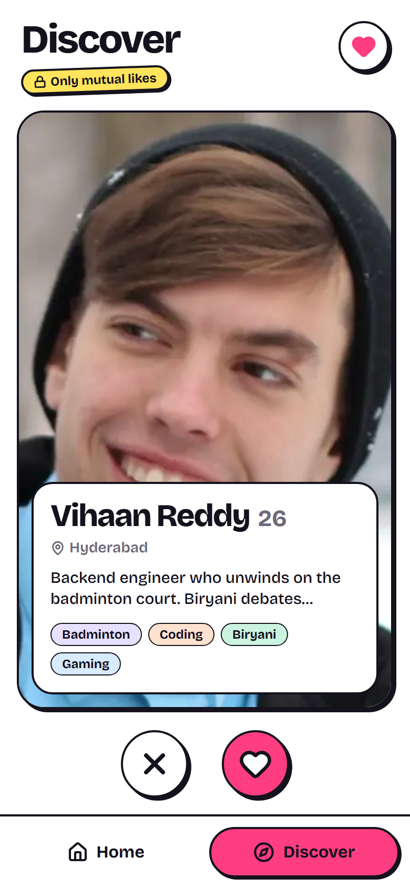
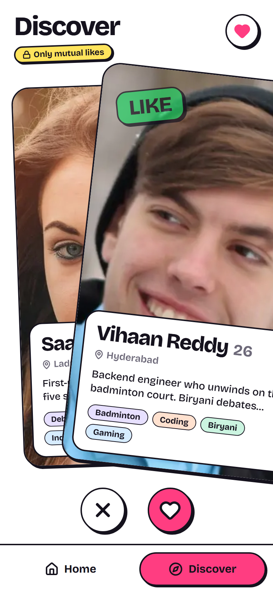
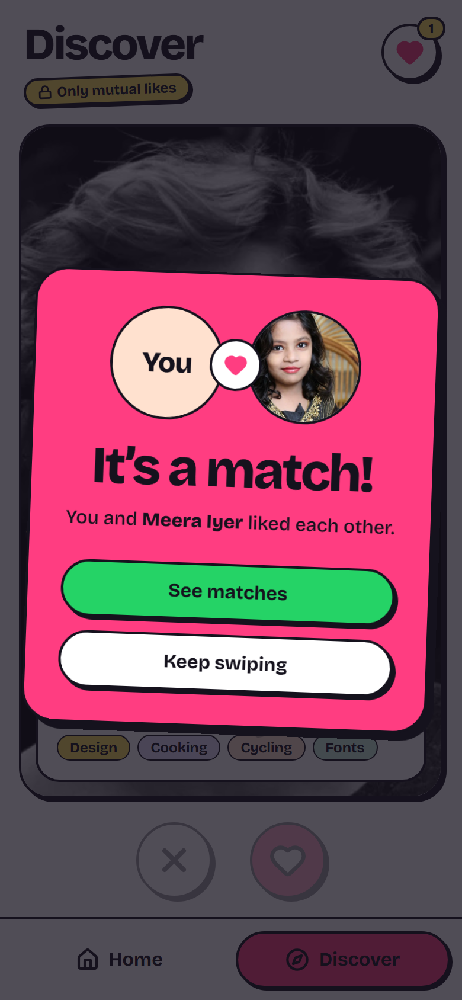
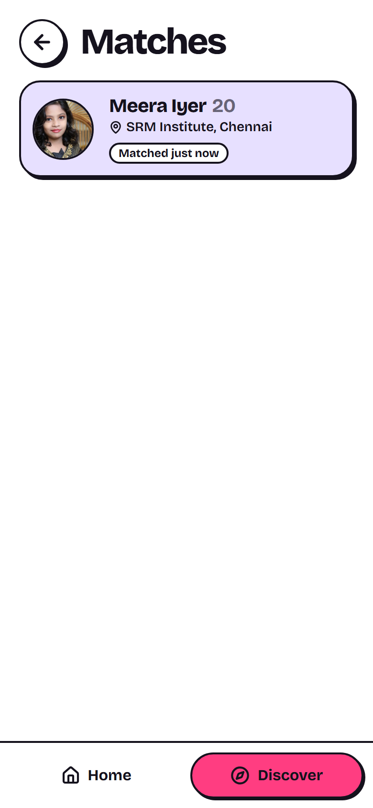
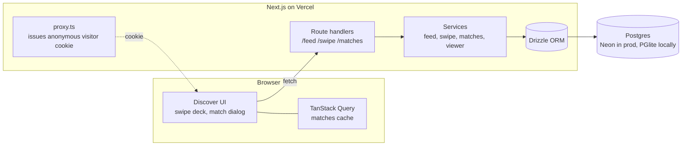

# Coy Discover

A swipe-based **Discover** tab for [Coy](https://getcoy.com), the double-blind crush-matching app, built as a standalone app with a placeholder **Home** tab beside it.

[](https://github.com/Halok600/coy-discover/actions/workflows/ci.yml)

Swipe right to like, left to pass. A match happens **only when both people liked each other**, and nothing in the app, the API, or the order of the deck ever reveals who liked you first. That is Coy's core promise, and it is the part of this project that is tested hardest.

<p>
  
  
  
  
</p>

## Features

- **Swipe deck**: one card at a time, drag gestures on touch and mouse, **Like / Pass buttons** and **← / → keys** on desktop. The card follows your finger, tilts, and shows LIKE / NOPE stamps; release past the threshold (or flick) and it flies off, otherwise it springs back.
- **Never repeats**: a swiped profile never appears again, even across reloads or while its swipe is still in flight.
- **It's a match!** dialog on a mutual like (focus-trapped, `Esc` to close, confetti unless you prefer reduced motion) and a **Matches** view listing everyone you matched with.
- **Clear states**: loading skeletons, an offline/error state with retry, a "You're all caught up" empty state with **Start over**.
- **Persistent**: swipes and matches live in Postgres, so they survive reloads.
- **Coy's own look**: Bricolage Grotesque, ink outlines with hard offset shadows, pastel cards, pill buttons and the tilted pink match card, taken from the design tokens on getcoy.com.
- **Mobile-first**, with a framed device-style column on desktop, `prefers-reduced-motion` support and screen-reader announcements for each swipe.

## Privacy design

The brief says: _never reveal who has liked the user unless it is mutual_. Each way a build could leak that, and what stops it here:

| Leak                                              | What prevents it                                                                                                                                    | Enforced by                                          |
| ------------------------------------------------- | --------------------------------------------------------------------------------------------------------------------------------------------------- | ---------------------------------------------------- |
| A `likedYou` flag or raw DB rows in `GET /feed`   | Every response is built field by field in one serializer (`toPublicProfile`); a new column can't leak by accident                                   | `privacy.test.ts` asserts the exact key set          |
| Deck order that puts admirers first               | The deck is ordered by `md5(viewer_id \|\| profile_id)`: stable per visitor, unrelated to likes                                                     | `privacy.test.ts` recomputes the order independently |
| `POST /swipe` answering differently for admirers  | The reciprocal lookup runs for **every** swipe; a pass on an admirer returns byte-for-byte the same `{ "matched": false }` as a pass on anyone else | `privacy.test.ts`, `routes.test.ts`                  |
| Probing by re-swiping                             | Swipes are final: the `(swiper, target)` primary key makes a second swipe a `409`, so an outcome can't be re-rolled                                 | `swipe.test.ts`, e2e                                 |
| A "who liked me" endpoint, count, or badge        | None exists. The only relationship the API ever exposes is a mutual match, and the header badge counts matches only                                 | Code review + e2e                                    |
| Filtering in the browser                          | All filtering happens in SQL on the server                                                                                                          | Architecture                                         |
| Forged identity cookie acting as a seeded profile | The viewer cookie is validated as a UUID and refused if it names a seeded member                                                                    | `routes.test.ts`                                     |
| One visitor seeing another's data                 | Every query is scoped to the visitor's id                                                                                                           | `privacy.test.ts`, e2e                               |

## How it works



- **Identity.** The brief says to assume one logged-in user. On a public demo that would let the first visitor use up the deck for everyone, so each visitor gets an anonymous, HttpOnly cookie (set in `proxy.ts` on page load) that stands in for "the logged-in user". There is no login and no external auth.
- **Seeded admirers.** The first time a visitor is seen, 8 to 10 seeded members are recorded as having already liked them (chosen per visitor), so matches happen in a demo. They are stored as ordinary swipe rows and are only revealed through the normal mutual-match path.
- **Layers.** Route handlers parse the request and map errors; `src/server/services/*` hold the business rules and take the database as a parameter (so tests run on in-memory Postgres); Drizzle talks to Postgres.
- **One database, two drivers.** With `DATABASE_URL` set, the app uses `pg` (Neon in production). Without it, it runs an embedded Postgres (PGlite) in `.data/` and seeds itself, so `npm run dev` needs no setup.
- **Optimistic UI.** The card leaves instantly and `POST /swipe` runs in the background; if it fails the card returns with a message. The deck refills from `/feed` when three cards remain.

### Data model

```
users    id, kind ('member' | 'viewer'), name, age, photo_url, bio, location, interests[], created_at
swipes   (swiper_id, target_id) PRIMARY KEY, action ('like' | 'pass'), created_at
matches  id, user_a, user_b  UNIQUE, CHECK (user_a < user_b), created_at
```

`swipes` has no `UPDATE` path, so swipes are final. `matches` stores each pair once in canonical order. Deleting a visitor cascades to their swipes and matches.

## API

The brief's paths work as written (`/feed`, `/swipe`, `/matches`); they are rewritten to route handlers under `/api`. All responses are `Cache-Control: no-store`. Errors share one envelope: `{ "error": { "code", "message" } }`.

### `GET /feed?limit=10`

Profiles the visitor has not swiped on yet (`limit` 1 to 30).

```json
{
  "profiles": [
    {
      "id": "00000000-0000-4000-8000-00000000001a",
      "name": "Neel Saxena",
      "age": 27,
      "photoUrl": "https://i.pravatar.cc/640?img=68",
      "bio": "Runs a small family cafe and a smaller podcast.",
      "location": "Indore",
      "interests": ["Podcasts", "Poha", "Entrepreneurship", "Badminton"]
    }
  ],
  "hasMore": true
}
```

### `POST /swipe`

```http
POST /swipe
Content-Type: application/json

{ "profileId": "00000000-0000-4000-8000-00000000001a", "action": "like" }
```

Not a match (a pass, or a like nobody returned), always this exact body:

```json
{ "matched": false }
```

A mutual like:

```json
{
  "matched": true,
  "match": {
    "id": "5b0c…",
    "matchedAt": "2026-11-18T10:21:04.512Z",
    "profile": { "id": "…", "name": "Mahi Rathore", "age": 21, "…": "…" }
  }
}
```

Errors: `400 VALIDATION_ERROR` (bad body), `404 PROFILE_NOT_FOUND`, `409 ALREADY_SWIPED`.

### `GET /matches`

```json
{ "matches": [{ "id": "5b0c…", "matchedAt": "…", "profile": { "…": "…" } }] }
```

### Other routes

| Route                   | Purpose                                                                                              |
| ----------------------- | ---------------------------------------------------------------------------------------------------- |
| `POST /api/demo/reset`  | "Start over": clears the visitor's swipes and matches and restores a fresh deck                      |
| `GET /api/health`       | Liveness probe that also checks the database                                                         |
| `GET /api/cron/cleanup` | Daily Vercel Cron job that removes idle demo visitors; requires `Authorization: Bearer $CRON_SECRET` |

## Run it locally

Requires Node.js 22 or newer.

```bash
npm install
npm run dev        # http://localhost:3000, zero config
```

The first request creates an embedded database in `.data/` and seeds 32 profiles. Delete `.data/` to start fresh.

To use a real Postgres instead, copy `.env.example` to `.env.local`, set `DATABASE_URL`, then run `npm run db:migrate && npm run db:seed`.

## Tests

```bash
npm test             # 80 unit and API tests on in-memory Postgres
npm run test:e2e     # Playwright, mobile (Pixel 7) and desktop Chrome
npm run lint && npm run typecheck && npm run format:check
```

First time only: `npx playwright install chromium`.

- **Unit** (`tests/unit`): matching rules, swipe finality, feed behaviour, viewer lifecycle (including concurrent first requests), idle cleanup, seed data, and the privacy guarantees above.
- **API** (`tests/api`): the real route handlers called with real `Request` objects: cookies, validation, status codes, error bodies, cron authorization.
- **End-to-end** (`e2e`): drag and button swipes, arrow keys, snap-back on short drags, no repeats after reload, a full run through the deck to the caught-up state, matches persisting across reloads, restart, and isolation between visitors. The e2e server uses its own throwaway database (`PGLITE_DATA_DIR=.data/e2e`).

CI (`.github/workflows/ci.yml`) runs format, lint, types, unit tests and a production build, plus the e2e suite.

## Deploy (Vercel + Neon)

1. Push this repo to GitHub and **import it in Vercel** (the Next.js preset is detected automatically).
2. In the Vercel project, open **Storage → Create → Neon (Postgres)** and connect it. This injects `DATABASE_URL`. Pick a region close to your functions.
3. Add an environment variable **`CRON_SECRET`** (any random string of 16+ characters). Vercel Cron sends it automatically.
4. Deploy. The `vercel-build` script runs `db:migrate` and `db:seed` before `next build`, so the database is ready on first load. `vercel.json` schedules the daily cleanup job.

Preview deployments share the same database unless you enable Neon's branch-per-preview option.

## Project structure

```
src/
  app/                 pages (/, /discover, /discover/matches) and route handlers (/api/*)
  components/          swipe card, profile card, controls, match dialog, state screens
  lib/                 API client, deck state hook, shared wire types, formatters
  server/
    db/                Drizzle schema and the Postgres / PGlite client
    services/          feed, swipe, matches, viewer: all business rules
    seed/              32 mock profiles and the idempotent seeder
    dto.ts             the single public-profile serializer
    http.ts            route wrapper: visitor cookie, error envelope, no-store
  proxy.ts             issues the anonymous visitor cookie on page loads
drizzle/               SQL migrations
tests/                 unit and API tests (Vitest)
e2e/                   end-to-end tests (Playwright)
scripts/               db:migrate, db:seed, README screenshots
```

## Trade-offs and what I'd do next

- **Anonymous cookie instead of auth**, as the brief allows. In Coy proper this is the signed-in user id; nothing else would change.
- **Synthetic admirers.** Real likes would come from real users; seeding them as swipe rows keeps the matching code identical.
- **No rate limiting.** A production build would limit `/swipe` per user to slow down scripted probing (Vercel WAF or a token bucket in Redis).
- **Photos are hotlinked placeholders** from [pravatar.cc](https://pravatar.cc), served through the Next.js image optimizer. Names, bios and people in the seed data are fictional; a failed image falls back to initials.
- **CSP allows inline scripts**, because Next.js injects inline bootstrap code. Nonce-based CSP would tighten it.
- **Swipes are final by design** (it's what stops probing), so there is no undo.

## License

[MIT](LICENSE)
